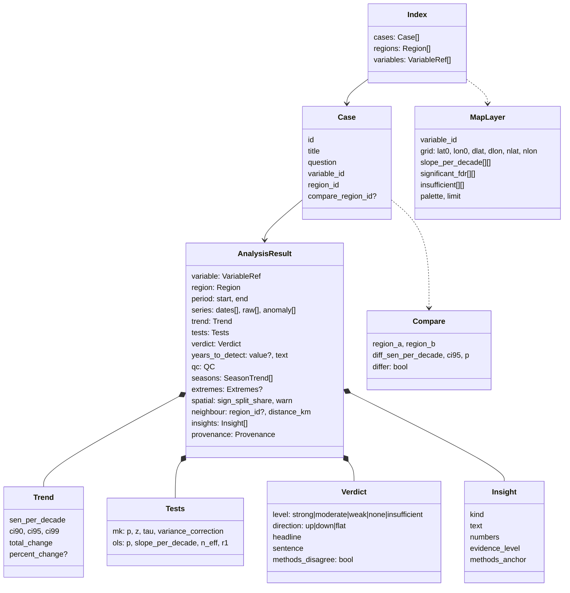
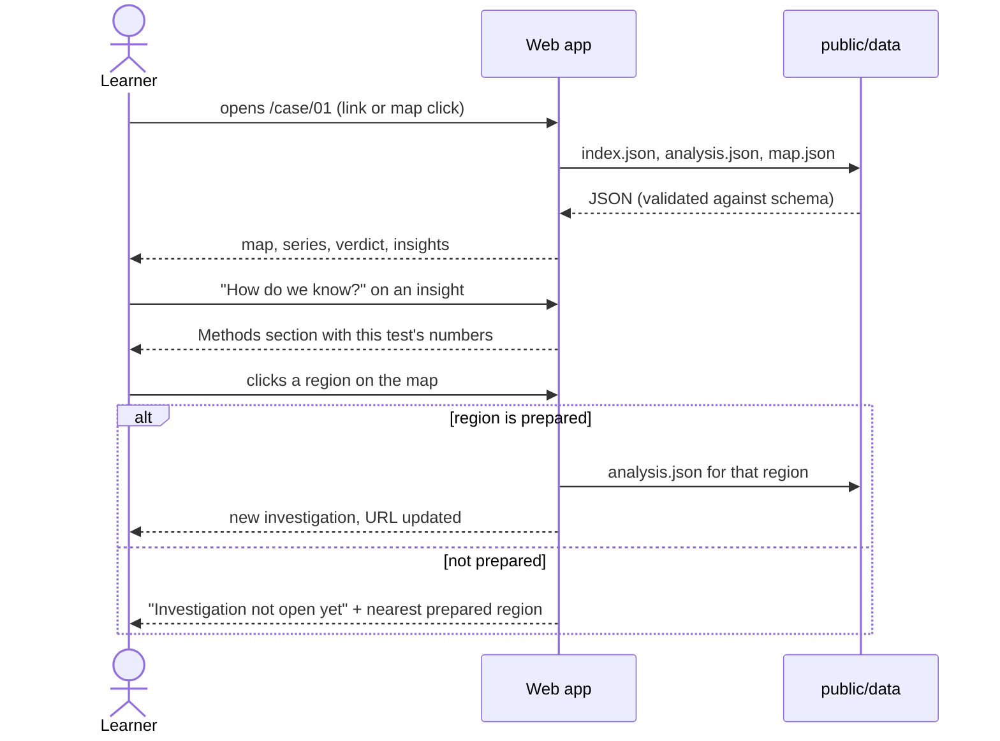
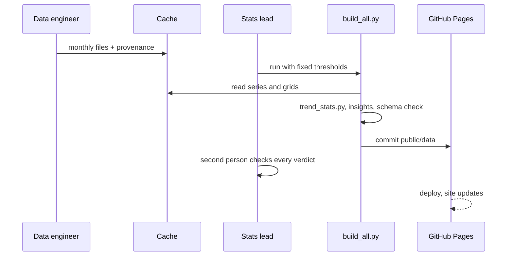

# Trend Detective — plan v2

Nov 14, 2026 · Mykolaa

> Translated from the team's Ukrainian planning doc. Embedded diagrams and mockup images live in the
> team's shared doc and are referenced below by caption only. Statistical methods and glossary:
> [2026-11-14-stats-methods.md](2026-11-14-stats-methods.md).

## Product

Trend Detective is a static web app. A world map shows where a variable is rising and where it is
falling. For a chosen region the app opens an investigation: a chart, a verdict from a test with an
autocorrelation correction, and 3–5 insights in plain language.

The statistics are deep, but they reach the user in only one form: an insight a high-school student
can understand. Test tables live on the Methods page.

| # | Decision | Source |
| --- | --- | --- |
| 1 | The first screen is a world map with a case already open on top of it | Q6 |
| 2 | 4–6 regions are precomputed and served instantly. The map covers the whole world. A click outside these regions gives an honest "investigation for this region is not open yet", not an error | Q7 |
| 3 | No wizard; instead a catalog with "topic" and "place type" filters | Q8 |
| 4 | The app itself suggests a neighbouring region with the opposite trend | Q9 |
| 5 | Export: CSV, chart PNG, link with the state in the URL | Q10 |
| 6 | Interface in English; Ukrainian after the MVP | Q11 |
| 7 | The metaphor stays: case = region + variable, evidence = map and chart, verdict = test result | Q3 |
| 8 | Stack: Python precomputes everything into JSON; static site (React + MapLibre + Plotly) on GitHub Pages. No server that could fall asleep during judging | Q28 |
| 9 | Light theme; dark is optional. Palettes from `trend-viz` | Q14–15, decided in the plan |
| 10 | The verdict is phrased via the confidence interval. If MK and OLS disagree, we take the weaker verdict | Q18–19, decided in the plan |
| 11 | "Years to detection" is one rounded number with the condition "if the current rate holds" | Q20, decided in the plan |
| 12 | Hamed-Rao is removed from public claims | Q24 |

We are not planning the presentation and pitch yet. The team may change the "decided in the plan"
rows.

## Use cases

> Diagram: use cases · 2 web-app actors, 2 precompute actors.

The app has two worlds. In the web app people only read and click. Everything that is computed lives
in the offline precompute, and the only link between them is a set of JSON files. The Learner also
uses the catalog and export; those lines are omitted to keep the diagram readable.

## Visuals

The app should look like a clean scientific instrument: white background, black text, colour only in
the data. Nothing that resembles AI products: no beige "paper", no orange or purple accents, no
gradients, no serif headings. The investigation metaphor lives in the words and in the order of the
page: question → where → how it changed → verdict → what we found.

### Rules

- **Colour.** Background #FFFFFF, text #111418, secondary text #5E6570, lines #E3E5E8. Only data has
  colour: RdBu for temperature, BrBG for water, Okabe-Ito for two regions. Active UI elements are
  black
- **Font.** One: Inter, tabular figures. Sizes: 28 heading, 22 verdict, 14 body, 12.5 captions
- **Verdict.** A headline, a 5-segment evidence scale, two numbers (rate with range, total change) and
  one "How sure?" line. Nothing else
- **Insight.** One sentence and a "How do we know?" link. Below the list: how many checks were run
  and how many are shown
- **No** gradients, shadows, emoji, decorative icons, badges or animation for its own sake. 1 px
  borders, 6 px radius
- **Map.** Coastlines and borders come from the MapLibre basemap. In the mockups the outlines are
  drawn roughly by hand

### Screens

| Screen | What is on it | From which JSON |
| --- | --- | --- |
| Map (start) | World map with the trend of the chosen variable, prepared regions outlined, case 01 card on top | `map.json`, `index.json` |
| Case | Question → Where (regional map) → Over time (series) → Verdict → What we found | `analysis.json` |
| Compare | Two series, two verdicts, a "Do the trends really differ?" line, neighbour suggestion | 2 × `analysis.json` + `compare` |
| Catalog | 8–10 variables, "topic" and "place type" filters, two sentences per variable | `catalog.json` from `variables.yaml` |
| Methods | Pipeline, simulation table, cross-check with literature, limitations | static text + `validation.md` |

The top bar always shows the current variable, region and period with the source. The screen state
is stored in the URL, so "Share link" opens the same investigation.

### Mockups

One mockup per page. The data are synthetic, except the chart on Methods: it shows the real numbers
of our simulation from `10-methods.md` (240 months, 300 runs).

1. **Map** (start). Variable picker and three cases on the left, trend map on the right. Prepared
   regions are outlined.
   > Mockup: Map page — world temperature-trend map, case list on the left.
2. **Case**: question, regional map, series, verdict and three insights.
   > Mockup: Case page — regional map, time series, verdict, insights.
3. **Compare**: two series stacked, two verdicts and a separate answer to whether the trends really
   differ.
   > Mockup: Compare page — two regions with opposite trends.
4. **Catalog**: two rows of filters instead of a wizard, and a table of variables with plain-language
   definitions.
   > Mockup: Catalog page — topic and place-type filters, variable table.
5. **Methods**: analysis steps in plain words, a false-alarm chart, and how many checks we ran.
   > Mockup: Methods page — analysis steps and the tests' false-alarm chart.

## Statistics

The statistics team delivers two files: `analysis.json` for each "region × variable" pair and
`map.json` for each variable. All numbers are computed by one module, `trend_stats.py`. The visual
layer computes nothing; it only draws these JSON files. The file format is in the UML section.

> Diagram: statistics pipeline · from raw data to JSON.

Every series follows the same path. The branches on the right are steps that switch on for certain
data; they are listed in the table below.

Glossary, formulas and advanced methods for insights: see
[2026-11-14-stats-methods.md](2026-11-14-stats-methods.md).

### Use cases: data arrived — what next

| ID | What data arrived | What we do | What appears in the JSON |
| --- | --- | --- | --- |
| S1 | Monthly regional series (POWER) | cos(latitude)-weighted mean → anomalies → Sen + MK Yue-Wang + OLS n\_eff → verdict | `series`, `trend`, `tests`, `verdict` |
| S2 | Daily data | To monthly: mean for states (T2M, soil moisture, NDVI), sum for fluxes (precipitation). A month counts if ≥ 80% of days are present. Then S1 | `qc.aggregation` |
| S3 | Satellite series with gaps (OMI, MODIS) | Gaps are not filled. Monthly climatology only from ≥ 5 years. If valid months < 80%, the series → insufficient | `qc.coverage` |
| S4 | Known break or sensor change (GRACE 2017–2018, OMI) | Pettitt test for a jump. A significant jump gives a warning, not a trend | `qc.break` |
| S5 | Series shorter than 10 years | Verdict insufficient; slope not shown | `verdict.level` |
| S6 | Any monthly series ≥ 20 years | Seasons: 4 series of seasonal means (DJF, MAM, JJA, SON), `obs_per_year=1`. We show all four | `seasons[]` |
| S7 | Soil moisture, precipitation, T2M (grandma's case) | Extremes. Threshold = 10th (or 90th) percentile of 1981–2010 anomalies. Count "dry months" per year and test Sen + MK on the annual counts | `extremes` |
| S8 | Grid (map) | The same pipeline in every cell → BH FDR q = 0.05 → stippling where the trend is significant | `map.json` |
| S9 | Grid inside a region | Sign split: if ≥ 15% of the area has a significant trend of the opposite sign, warn "the average hides a contrast" | `spatial.sign_split` |
| S10 | Two regions | Each goes through S1. Plus the trend of the difference A − B over common months. "Trends differ" is written only when this trend is significant | `compare` |
| S11 | All prepared regions of one variable | Neighbour suggestion: the nearest region with a significant trend of the opposite sign. If there is none, no suggestion is shown | `neighbour` |
| S12 | Finished case result | Cross-check: compute the same trend in KNMI Climate Explorer and compare with published values (GISTEMP, IPCC AR6 for the region) | `validation.md` |

The 80%, 5-year and 15% thresholds are our proposals. The stats lead fixes them before the first run.

### Verdict

The level is computed separately for MK and for OLS, and we show the **more conservative (weaker) of the
two**, as `.claude/skills/trend-stats/SKILL.md:26-28` and decision 10 above require. If they disagree, the
card also shows a "Two methods disagree" line. For MK the CI condition and the p condition gave the same
decision in 3,600 simulations, but they can differ at the boundary on real data: the stats-archive v1.4
tables have 4 such rows (Sen CI touching 0 while p < 0.05, or the reverse; GLDAS-2.1 snowfall monthly in
3 regions, MODIS LST night clear days annual on the mask). So the text is phrased via the range, and a
boundary row takes the weaker of the two conditions. (Changed 2026-11-14, merge plan v2 Q8; the earlier
text "show the better of the two" contradicted the skill.)

| Level | Condition | Card headline (EN) |
| --- | --- | --- |
| strong | 99% CI of the slope excludes 0 (p < 0.01) | Strong evidence: getting warmer |
| moderate | 95% CI excludes 0 (p < 0.05) | Evidence: getting warmer |
| weak | 90% CI excludes 0 (p < 0.10) | A hint, not proof |
| none | otherwise | No clear trend yet |
| insufficient | < 10 years or < 80% valid months | Not enough data to judge |

"Years to detection" is shown only for none and weak. The number is rounded to 5 years. If it exceeds
50, we write "the change is small next to natural swings". If the slope is ≈ 0, no number is given.
Wording: "If the current rate held, about 15 more years of data would be needed to tell." On Methods
we state honestly that the estimate is noisy: for a true 42 years we obtained anywhere from 33 to 79.

### Insights

An insight is a plain sentence with a number, generated by code from a rule. It appears only when its
condition is met. An insight never sounds stronger than the verdict, and each has a "How do we know?"
link to its test.

| Insight | Show condition | Example wording |
| --- | --- | --- |
| Total change | verdict ≥ moderate | Since 1981 it got about 2.1 °C warmer (1.7–2.5) |
| Signal vs noise | total change > std of annual means | The change is now bigger than a normal year-to-year swing |
| Season | the fastest season is significant and its CI does not overlap the slowest one's CI | Winters are warming about twice as fast as summers |
| Extremes | MK on the counts is significant | Dry months: 1 a year in the 1980s, 3 a year in the last decade |
| Neighbour | there is a region from S11 | 900 km south, the same variable moves the other way |
| Heterogeneity | S9 fired | The regional average hides a wetter north and a drier south |
| Not visible yet | verdict none | Too noisy to tell yet; about 15 more years needed at this rate |
| Caveat | S4 fired or the methods disagree | A jump in 2017 matches a satellite gap, read with care |

The table gives example wordings; the numbers are made up. Choosing the start of the period so that
the trend becomes significant is forbidden: the period is always the whole series.

## UML

### Components

> Diagram: components · 3 zones of responsibility.

The statistics team owns the left zone, the visual team the right one. The middle zone is shared and
changes only with the agreement of both.

### Contract: what is in the JSON

All texts (`headline`, `sentence`, `Insight.text`) are generated by the statistics side from
templates, and the visual side does not rewrite them. That way a number in the text always matches the
number on the chart. Numbers are rounded in the JSON itself, not by the browser.

### Sequence: a person opens a case

## Who does what and when

There are two teams. **Statistics** (stats lead, data engineer, intern) delivers JSON. **Visual**
(Claude builds the site, a human owns taste and copy) draws that JSON. Work runs in parallel from the
first hour, because the file format is frozen as the first step and the visual team works on fake
JSON in the same format.

| Statistics delivers | Visual delivers |
| --- | --- |
| `analysis.json` format frozen, one real file (Ukraine, T2M) | Site skeleton that reads fake JSON |
| S1–S5 for the three case regions, `map.json` for T2M | Map, chart and verdict on real data, public deploy |
| S6, S7, S9–S11 and the insight generator | Insights panel, comparison, case mode, catalog filters |
| S12 cross-check, all 4–6 regions | Export, Methods, dark theme, contrast check |
| Feature freeze. Test with three people: a student, a parent, a scientist | — |

First-wave cases are built on POWER, as the lowest risk. Results are not known in advance.

1. **Grandma's drought.** Root-zone soil moisture and precipitation, southern Ukraine. Insights: dry
   months (S7) and growing season (S6)
2. **Is Ukraine getting warmer?** T2M, the whole country. Insights: seasons and signal vs noise
3. **Same rain, opposite ways.** Precipitation, northern and southern Europe. Insights: neighbour and
   the trend of the difference (S10–S11)

The data engineer pulls satellite variables (NO₂ OMI, NDVI MODIS) in parallel. They enter cases only
after passing S3 and S4.

### Definition of done

- [ ] Statistics: every JSON passes schema validation, every verdict was checked by a second
  mathematician, two numbers have a cross-check against the literature
- [ ] Visual: a person opening the site for the first time can retell the verdict and one insight in
  their own words within 3 minutes
- [ ] Together: the site opens from another network without login, and no click leads into a void
